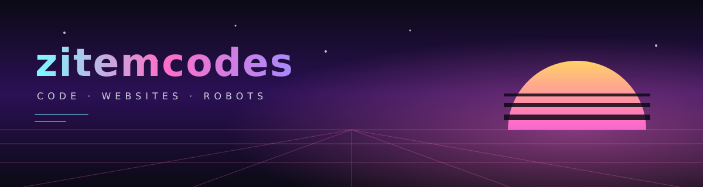

 

### What's here

Websites, code and hardware projects built by **Zitem Edozie**, a young developer in Lagos, Nigeria.

Each repository is a project he built himself. Every one has a README in his own words: what it does, how he made it, what went wrong, and what he would change next time.

The code is his, unedited, including the parts that aren't tidy yet.

### About this account

GitHub requires account holders to be 13 or over. Zitem is under 13, so this account is owned and maintained by his father, who reviews everything before it is published. The work is Zitem's own.
